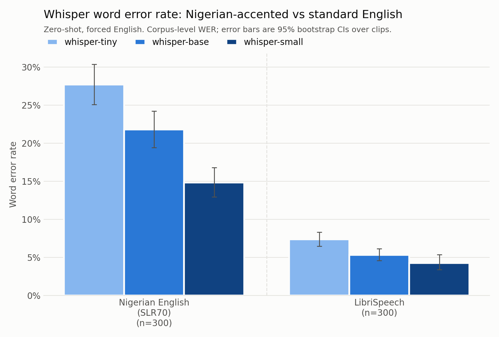

# naija-asr-eval

**How much worse do open speech-recognition models perform on Nigerian-accented English than on standard English, and what kinds of errors do they make, especially on Nigerian names?**

A focused, zero-shot evaluation of OpenAI's Whisper (tiny, base, small) on Nigerian English, with an error analysis of proper nouns. Everything runs on Google Colab's free GPU. The scoring code is plain Python, unit-tested on an ordinary laptop.

> **Status (November 2026):** results below are for **SLR70**, Google's crowdsourced Nigerian English corpus, against a **LibriSpeech** baseline. The accent-by-accent analysis (Yoruba, Igbo, Hausa, other Nigerian) uses **AfriSpeech-200**, which is gated. The code for it is built and tested, and will run once dataset access is approved.

## Research questions

1. How does word error rate (WER) differ for Nigerian-accented English compared with standard English? With AfriSpeech: across Yoruba, Igbo, Hausa and other Nigerian accents.
2. Does a bigger model close the gap?
3. Which errors are most common, and how often are Nigerian names and other proper nouns mangled? The motivating example: I say "Sobande" and speech-to-text writes "show bandit".

## Key findings (SLR70 vs LibriSpeech, 300 clips each)

- **Whisper makes about 3.5× more word errors on Nigerian English than on LibriSpeech, at every model size.** Whisper-small: **14.8%** vs **4.3%** WER.
- **A bigger model narrows the gap in absolute terms but not in relative terms.** From tiny to small, the gap halves from 20.3 to 10.5 percentage points, but the ratio stays between 3.4× and 4.1×. Every model improves on both datasets, roughly in proportion.
- **The gap is not a formatting artefact, and not an artefact of a few speakers.** Scored with Whisper's own text normaliser (which treats "thirty" and "30", or "colour" and "color", as equal), whisper-small's gap is still **9.1 points (95% CI 6.7–11.6)**, with intervals that resample whole speakers.
- **Proper nouns are much harder.** Whisper-small got **one in three** likely proper nouns wrong (33.4%) in the Nigerian sentences. Tiny and base got about half wrong. Of 344 distinct proper nouns (one per clip), 107 were wrong for all three models.
- **Sanity check:** with Whisper's normaliser, our LibriSpeech results (tiny 7.0%, base 4.7%, small 3.5%) are close to those reported in the Whisper paper on the full test set (7.6%, 5.0%, 3.4%; Radford et al., 2023, Table D.1.1). That is evidence the pipeline measures correctly.



## Results

### Word error rate, main metric

Corpus-level WER (total errors ÷ total reference words) with 95% bootstrap confidence intervals. "Clip CI" resamples clips; "speaker CI" resamples whole speakers, which is more honest when there are few speakers.

| Model | Data | Speakers | WER | Clip CI | Speaker CI | Subs | Dels | Ins |
|---|---|---|---|---|---|---|---|---|
| whisper-tiny | Nigerian English (SLR70) | 31 | **27.7%** | 25.1–30.4 | 23.6–31.8 | 20.8 | 2.9 | 4.0 |
| whisper-tiny | LibriSpeech | 40 | 7.4% | 6.5–8.3 | 6.3–8.4 | 5.7 | 0.8 | 0.9 |
| whisper-base | Nigerian English (SLR70) | 31 | **21.8%** | 19.4–24.2 | 18.3–25.1 | 16.2 | 2.5 | 3.1 |
| whisper-base | LibriSpeech | 40 | 5.3% | 4.6–6.1 | 4.6–6.1 | 4.1 | 0.8 | 0.5 |
| whisper-small | Nigerian English (SLR70) | 31 | **14.8%** | 13.0–16.8 | 12.4–17.3 | 10.6 | 1.7 | 2.5 |
| whisper-small | LibriSpeech | 40 | 4.3% | 3.4–5.4 | 3.5–5.3 | 2.8 | 1.2 | 0.3 |

Subs, Dels and Ins are substitutions, deletions and insertions per 100 reference words; they add up to the WER. Substitutions dominate everywhere. Insertions are relatively more common on Nigerian speech, often because one word is heard as several ("Awolowo Way" → "our world war").

### Gap vs LibriSpeech, and the robustness check

Gap = Nigerian WER − LibriSpeech WER for the same model, in percentage points, with a 95% CI that resamples speakers in both groups.

| Model | Gap, our normaliser | Gap, Whisper's normaliser | WER with Whisper's normaliser (SLR70 / LibriSpeech) | Ratio |
|---|---|---|---|---|
| whisper-tiny | +20.3 (16.0–24.4) | +19.1 (15.1–22.9) | 26.1% / 7.0% | 3.7× |
| whisper-base | +16.5 (13.0–19.8) | +15.4 (12.2–18.4) | 20.1% / 4.7% | 4.3× |
| whisper-small | +10.5 (7.9–13.2) | +9.1 (6.7–11.6) | 12.6% / 3.5% | 3.6× |

No interval comes near 0.

### Proper nouns (Nigerian English, SLR70)

| Model | Likely proper nouns checked | Exactly right | Error rate (95% CI) |
|---|---|---|---|
| whisper-tiny | 353 | 172 | 51.3% (44.4–57.9) |
| whisper-base | 353 | 191 | 45.9% (39.6–52.4) |
| whisper-small | 353 | 235 | 33.4% (27.5–39.5) |

"Likely proper noun" is a **heuristic**, not named-entity recognition (see Method). LibriSpeech is excluded because its transcripts are all capitals.

### Three real failure examples (whisper-small)

**1. Two speakers, one street name, two different mishearings.** The same SLR70 sentence, read by a woman and a man:

| | |
|---|---|
| Reference | Continue onto **Awolowo Way** |
| Speaker A heard as | Continue on to **our world war v.** (WER 150%) |
| Speaker B heard as | Continue on to **our lower way.** (WER 100%) |

The model has no "Awolowo" to fall back on, so it builds the nearest common English words. One name becomes three or four words, and WER goes over 100%.

**2. A full Nigerian name and a university collapse into English-sounding words.**

| | |
|---|---|
| Reference | **Ebube Nwagbo** studied Mass Communication at **Nnamdi Azikiwe** University. |
| Model output | **It will be one both** study mass communication and **NAMD as a QA** University. |

The ordinary English in the middle ("mass communication", "University") survives. Every Igbo name is lost.

**3. City names become everyday words.**

| | |
|---|---|
| Reference | They threatened to destroy refineries in **Port Harcourt** and **Warri** within forty-eight hours. |
| Model output | They threatened to destroy refineries in **Potarkot** and **Worry** within 48 hours. |

"Warri" becomes "Worry". "Port Harcourt", one of Nigeria's largest cities, comes out as a made-up word. ("forty-eight" vs "48" is a formatting difference; Whisper's normaliser would not count it.)

More: [results/worst_clips.csv](results/worst_clips.csv), [results/proper_noun_errors.csv](results/proper_noun_errors.csv) and [results/top_substitutions.csv](results/top_substitutions.csv).

## Method

### Data

| Dataset | Role | Sample | Licence |
|---|---|---|---|
| [SLR70](https://openslr.org/70/), Crowdsourced high-quality Nigerian English speech (Google) | Nigerian English | 300 clips: 150 female + 150 male, from 31 speakers | CC BY-SA 4.0 |
| [AfriSpeech-200](https://huggingface.co/datasets/intronhealth/afrispeech-200) (gated) | Nigerian accents, by L1 | ~75 general-domain clips each: Yoruba, Igbo, Hausa, other Nigerian (Hausa has only ~51 eligible) | CC BY-NC-SA 4.0 |
| [LibriSpeech](https://www.openslr.org/12) test-clean | Standard English baseline | 300 clips from all 40 speakers | CC BY 4.0 |

**Sampling** is fixed-seed (`SEED = 42`) and limits how much any one speaker can contribute:
- **SLR70** has only 31 speakers, who each recorded dozens to hundreds of sentences. We take clips **round-robin across speakers** within each gender: every speaker gives one clip before anyone gives a second.
- **AfriSpeech** keeps at most 3 clips per speaker and uses only the held-out test and dev splits. It excludes mixed accent labels such as "yoruba, hausa".
- **LibriSpeech** keeps at most 8 clips per speaker, because test-clean has only 40 speakers.

Clips longer than 30 seconds are excluded, because Whisper reads 30-second windows. Audio is resampled to 16 kHz mono, and **only the selected clips are decoded**.

### Models

`openai/whisper-tiny`, `whisper-base` and `whisper-small` from Hugging Face Transformers, run **zero-shot** (no fine-tuning):
- forced to English transcription (`language="en", task="transcribe"`)
- greedy decoding, fp16, on a free Colab T4 GPU

### Scoring ([metrics.py](metrics.py))

- **Normalisation, word by word.** Lowercase, remove accents and punctuation. Working one word at a time keeps word *i* of the normalised reference aligned with word *i* of the original, which the proper-noun analysis needs.
- **Alignment.** Word-level minimum edit distance (Levenshtein) with a fixed, documented tie-break, so the split into substitutions, deletions and insertions is reproducible.
- **Corpus-level WER.** Total errors ÷ total reference words, not the average of per-clip WERs, which would let a 3-word clip count as much as a 40-word clip. An empty model output counts every reference word as a deletion. WER can exceed 100%.
- **Confidence intervals.** 95% percentile bootstrap with 2,000 resamples, over clips or over whole speakers. The gap vs LibriSpeech resamples both groups independently.
- **Proper nouns (heuristic).** A capitalised word that does not start a sentence, is not "I" or a contraction of it, is not a title (Mr., Dr., Chief, Engr., …) and is not a single-letter initial. A full stop after an abbreviation such as "Mr." does not start a sentence. A name counts as right only if the model produced exactly that word in that place. The "heard as" column shows what the model wrote between the nearest correctly recognised neighbours.
- **Robustness check.** WER is recomputed with Whisper's English normaliser (numbers, British vs American spelling, contractions), as used in the Whisper paper.

### What is and is not new here

AfriSpeech-200's authors (Olatunji et al., 2023) and others have already benchmarked and fine-tuned speech models on African-accented English, including Whisper. This project does not claim a new benchmark. Its contribution is narrower:
- a reproducible zero-shot comparison of Nigerian English with a standard-English baseline, with honest uncertainty (speaker-level intervals and a normaliser robustness check)
- an error analysis of how proper nouns, especially Nigerian names and places, are mangled

## Limitations

- **Accent is confounded with recording conditions and text.** SLR70 is crowdsourced recordings of single sentences, many naming Nigerian people and places. LibriSpeech is audiobooks. Part of the gap may come from microphones, rooms or sentence content rather than accent alone. The AfriSpeech comparison *between* Nigerian accents, from one corpus, will be cleaner.
- **SLR70 has no accent labels.** It cannot answer research question 1 per accent. That needs AfriSpeech.
- **Few speakers.** SLR70 has 31 speakers (19 female, 12 male). The speaker-level intervals account for this, but 31 voices cannot represent Nigerian English as a whole. SLR70's volunteers recorded in Lagos and London.
- **The proper-noun measure is a heuristic.**
  - It counts capitalised non-names ("Road", "River", "American").
  - It misses names at the start of a sentence.
  - Its exact-match rule is strict: "Ijaw" heard as "Ijo", an accepted alternative name, counts as wrong.
  - It measures proper nouns in general, not only Nigerian names.
- **The main normaliser counts formatting differences as errors** ("thirty" vs "30"). The robustness check shows this changes WER by about 1–2 points and does not change the conclusions.
- **Only the three smallest Whisper models** fit comfortably in free Colab. Larger models may behave differently.
- **Possible training-data overlap.** Whisper's training data is not public. LibriSpeech and SLR70 are both public, so Whisper may have seen them.
- **Reference transcripts can contain errors.** The SLR70 page says the data was checked manually "but may still contain errors".

## How to run

### On Google Colab (does the evaluation)

1. Open [naija_asr_eval.ipynb](naija_asr_eval.ipynb) in Colab: File → Upload notebook.
2. Runtime → Change runtime type → **T4 GPU**.
3. Runtime → **Run all**. The notebook clones this repository to get `metrics.py` and `slr70.py`. If cloning fails, it asks you to upload them. Allow Google Drive access: it holds the audio cache and results, so a disconnect loses at most one batch.
4. The last cell checks that no audio is in `results/`, then downloads `naija_asr_results.zip`. Unzip it into `results/`.

With `DATASETS = ["slr70"]` (the default) no Hugging Face token is needed. For AfriSpeech:
1. Request access on its Hugging Face page.
2. Add a read token as the Colab secret `HF_TOKEN`.
3. Set `DATASETS = ["slr70", "afrispeech"]` and run all cells again. Saved samples and transcriptions are reused, so only the new clips are processed.

The pip install cell may print a `gcsfs`/`fsspec` dependency warning. It is expected and harmless.

### On a laptop (runs the tests, no GPU)

```bash
python -m venv .venv
.venv\Scripts\activate
pip install -r requirements.txt
pytest -v
```

On macOS/Linux, activate with `source .venv/bin/activate`. 64 tests cover the scoring and sampling logic, including:
- the "Sobande" → "show bandit" case: WER 0.5, one substitution plus one insertion
- WER above 100%
- length-weighted corpus WER
- "Mr." / "Dr." / "Mrs." handling
- empty model output
- speaker-level bootstrap intervals

## Repository layout

```
metrics.py                 scoring: normalisation, alignment, WER, bootstrap CIs, proper-noun heuristic
slr70.py                   SLR70 metadata parsing and gender-balanced, speaker-diverse sampling
test_metrics.py            unit tests for metrics.py
test_slr70.py              unit tests for slr70.py
naija_asr_eval.ipynb       Colab notebook: data, transcription, scoring, chart
results/                   CSVs and the chart from the latest run (no audio)
my_recordings_template.csv format for the optional own-recordings section
requirements.txt           laptop requirements (tests only)
requirements-colab.txt     extra packages the notebook installs on Colab
CODE_EXPLANATION.md        design decisions and a walkthrough of the code
LICENSE                    MIT licence for the code
```

## Data, privacy and licences

- **No audio is committed to this repository, ever.** `.gitignore` blocks audio formats, and the notebook refuses to package results if it finds any. Audio is cached only in the user's private Google Drive.
- Speaker IDs in the committed CSVs are replaced with per-run labels.
- **The code** (`.py` files and the notebook) is released under the [MIT License](LICENSE).
- `results/` contains reference transcripts, so those files inherit the dataset licences, not MIT:
  - SLR70: CC BY-SA 4.0
  - AfriSpeech-200: CC BY-NC-SA 4.0 (non-commercial)
  - LibriSpeech: CC BY 4.0

## References

- Olatunji, T., et al. (2023). AfriSpeech-200: Pan-African Accented Speech Dataset for Clinical and General Domain ASR. *Transactions of the Association for Computational Linguistics*. arXiv:2310.00274.
- Google. *Crowdsourced high-quality Nigerian English speech data set.* OpenSLR resource SLR70. https://openslr.org/70/
- Butryna, A., Chu, S.-H. C., Demirsahin, I., Gutkin, A., Ha, L., He, F., Jansche, M., Johny, C., Katanova, A., Kjartansson, O., Li, C., Merkulova, T., Oo, Y. M., Pipatsrisawat, K., Rivera, C., Sarin, S., de Silva, P., Sodimana, K., Sproat, R., Wattanavekin, T., & Wibawa, J. A. E. (2019). Google Crowdsourced Speech Corpora and Related Open-Source Resources for Low-Resource Languages and Dialects: An Overview. *2019 UNESCO International Conference Language Technologies for All (LT4All)*, Paris. arXiv:2010.06778.
- Panayotov, V., Chen, G., Povey, D., & Khudanpur, S. (2015). Librispeech: An ASR corpus based on public domain audio books. *ICASSP 2015*.
- Radford, A., Kim, J. W., Xu, T., Brockman, G., McLeavey, C., & Sutskever, I. (2023). Robust Speech Recognition via Large-Scale Weak Supervision. *ICML 2023*. arXiv:2212.04356.
